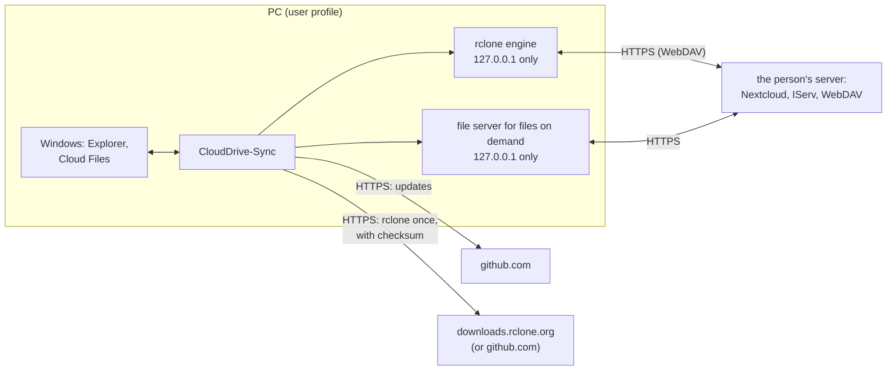

# Privacy and IT security

This overview is for **data protection officers and IT staff**, at schools for example, and for everyone who wants to
check what CloudDrive-Sync does with data. It describes data flows, stored data, logs, credentials, removal, and the
threats the program protects against - and those it cannot protect against.

Shorter, for users: the [privacy policy](../PRIVACY.md). How the program works inside: [ARCHITECTURE.en.md](ARCHITECTURE.en.md).
As of version 0.3 (test versions), October 2026. *Deutsch: [PRIVACY-SECURITY.md](PRIVACY-SECURITY.md).*

## At a glance

- CloudDrive-Sync runs **only on the PC** of the person using it. There is no server of the developer, no account with
  the developer, **no telemetry**, no crash reports, no advertising and no analysis of content.
- Files flow **only between the PC and the server the person enters** (Nextcloud, IServ or another WebDAV storage),
  encrypted over HTTPS.
- **Credentials** are kept on the PC only in encrypted form. The key is in the Windows Credential Manager, bound to the
  person's Windows sign-in.
- **No administrator rights:** program and data live in the user profile. For files on demand CloudDrive-Sync uses
  Windows' Cloud Files interface (as OneDrive does), no driver and no service of its own.
- **Open source** under the MIT License; every component is under an OSI-approved license
  ([THIRD-PARTY-NOTICES.md](../THIRD-PARTY-NOTICES.md)). Every version is built on GitHub from this source code.
- **Uninstalling** removes everything CloudDrive-Sync created; the synchronised files stay.

## Data flows

| Connection | Purpose | When | What is transferred |
|---|---|---|---|
| the person's server | synchronisation, folder listing, storage use, sign-in | every run (default: every 5 minutes and after changes on the PC) and when a file on demand is opened | files, file and folder names, credentials when signing in |
| browser → Nextcloud server | sign-in (Nextcloud Login Flow v2) | when an account is added | only in the person's browser; CloudDrive-Sync receives an app password |
| github.com | look for updates and download them | default: a few minutes after the start, then every 6 hours; with "Nur wenn ich nachsehe" only on request | the technical data of every web request (IP address, program version) |
| downloads.rclone.org, or github.com | download the tool rclone in its pinned version | at the first start | the technical data of the web request |
| 127.0.0.1 (this PC only) | rclone engine, file server for files on demand | while CloudDrive-Sync runs | nothing leaves the PC |

There are no other connections. The links under "Über" open in the browser only when clicked.

**Encrypted connections:** certificates are always checked; verification is switched off nowhere. CloudDrive-Sync takes
an unencrypted address (`http://`) only when the person ticks that explicitly when setting it up; the address preview
warns about it.

## What is stored where

| Place | Content | Protection | Kept |
|---|---|---|---|
| `%LOCALAPPDATA%\CloudDriveSync` | the program | user profile | until uninstalled |
| `%LOCALAPPDATA%\CloudDrive-Sync\settings.json` (and `.bak`) | accounts (label, kind, user ID and display name on the server), synchronisations (folders on the PC and in the cloud, selection, ignored paths, settings) | user profile; **no credentials** | until uninstalled |
| `…\CloudDrive-Sync\rclone.conf` | server addresses, user names, passwords or app passwords | **encrypted** (rclone's configuration encryption) with a random key | until the account is removed |
| Windows Credential Manager, entry `CloudDrive-Sync:config` | the key of `rclone.conf` | bound by Windows to the person's sign-in | until uninstalled |
| `…\CloudDrive-Sync\sync\<synchronisation>\` | state of each synchronisation: lists of all files with size and time, server times, history of runs with names of changed files, report of the last run | user profile; report redacted | lists: current state; history: 400 runs at most; report: the last one only |
| `…\CloudDrive-Sync\logs\` | logs (see below) | secrets redacted | 14 days |
| `…\CloudDrive-Sync\deps\` | rclone | checksum verified when downloaded | until uninstalled |
| registry, the user's part (HKCU) | autostart, program path, entries in Explorer's navigation pane | - | until removed or uninstalled |
| Windows' registry (SyncRootManager) | registration of every folder with files on demand: name, path, icon - created by Windows itself, as for OneDrive | managed by Windows | until the synchronisation is removed |
| synchronised folder on the PC | the files; hidden: `.clouddrive-sync` (sentinel, a fixed note) and `.clouddrive-papierkorb` (versions a run replaced or deleted) | the person's NTFS rights | recycle bin: 30 days by default, adjustable, 0 = off |
| cloud folder on the server | the files; `.clouddrive-sync` (a fixed note, nothing about the PC or the person); for a moment `CloudDrive-Sync-Sicherung-….tmp` while a file is replaced (files on demand); conflict copies `….Konflikt-PC1.…` | rights on the server | the sentinel stays (other PCs use it) |

CloudDrive-Sync keeps the content of files nowhere but in the synchronised folders themselves and their recycle bin.

## Logs

- **CloudDrive-Sync's log:** one file per day. It holds times, actions, file and folder names (also the paths of the
  folders on the PC), the names of the synchronisations, the server's address and error messages. Passwords, tokens and
  authorisation headers are redacted before anything is written. Files older than 14 days are deleted - at the start and
  at every new day.
- **rclone's log:** more detailed, with every file transferred and the addresses on the server (for Nextcloud they hold
  the user name). It is split into parts of 10 MB at most, 6 parts at most. Closed parts are deleted after 14 days; a
  part with entries older than 14 days is closed at the start. Limit: on a PC that runs for weeks without CloudDrive-Sync
  starting again, the open part keeps its entries until it reaches 10 MB.
- **Logs never leave the PC on their own.** Whoever needs help can pass them on themselves - best only the day in
  question, as they contain file names.

## Credentials

- **Nextcloud:** signing in happens in the browser on the person's own Nextcloud server. CloudDrive-Sync receives an
  **app password** of its own and never sees the actual password. If a password is entered instead, CloudDrive-Sync
  exchanges it for an app password at once where Nextcloud allows it. An app password can be revoked in Nextcloud at any
  time under *Settings › Security* - when a device is lost, for example.
- **IServ and other WebDAV storage:** user name and password are checked and stored only in the encrypted `rclone.conf`.
- Credentials never appear in logs, never on the command line of a process and never in the source code repository.

## Local services

CloudDrive-Sync starts rclone as its engine (`rclone rcd`) and, for files on demand, one file server per account. Both
listen **on 127.0.0.1 only** - not on the network -, on a random port and with **random credentials made anew at every
start**. CloudDrive-Sync passes these only through the environment of the child process, never on its command line.
Other Windows users of the same PC can reach the port, but cannot get in without those credentials.

## Removing and uninstalling

- **Removing a synchronisation:** the person chooses what stays on the PC (keep everything, download everything and
  keep it, or delete it from the PC). The registration with Windows ends only when nothing of it is left.
- **Removing an account:** its credentials leave `rclone.conf`. A Nextcloud app password should also be revoked in
  Nextcloud.
- **Uninstalling** removes the data folder (settings, encrypted credentials, state, logs, rclone), the key in the Windows
  Credential Manager, the folders' registrations with Windows, the Explorer entries, the autostart and the sentinel files
  on the PC. **What stays:** the synchronised folders with all their files, their recycle bin `.clouddrive-papierkorb`
  (it holds older versions - delete it yourself if it is not needed) and the sentinel file in the cloud.

## Threats and protection

| Threat | Protection in CloudDrive-Sync | What remains |
|---|---|---|
| A device is lost or stolen | credentials encrypted; key bound to the Windows sign-in | The synchronised files lie unencrypted on the disk, as with every sync program → use device encryption (BitLocker), revoke the app password |
| Other people on the same PC | everything in the person's own profile; local services only with random credentials | administrators of the PC can read everything - as with every program |
| Malware under the person's own Windows account | - | It can do whatever the person can, including decrypting credentials through Windows. No program can protect itself against that → antivirus, updates |
| Eavesdropping or tampering on the network (e.g. Wi-Fi) | HTTPS with certificate checks; `http://` only after explicit confirmation | with `http://` everything is readable → do not use it |
| Malicious or faulty entries on the server (e.g. in a shared folder) | names from the server stay names in the folder and reach no file outside it (tested); deletion guard; replaced and deleted versions go to the recycle bin on the PC; conflicts keep both versions; folders to read only are recognised | CloudDrive-Sync does not check the content of files → antivirus |
| Many files disappear on one side (by mistake, an error, a folder moved) | deletion guard: stop and ask from 50 % or 100 files (adjustable); a missing folder or sentinel file stops the run instead of deleting | - |
| A manipulated update | updates only from this project's GitHub releases, over HTTPS; every version is built on GitHub from the source code; the update system checks the checksum of every package | **no code signature yet** (applied for with the SignPath Foundation). Remaining risk: a taken-over GitHub account of the developer |
| A manipulated rclone | pinned version with a fixed SHA-256 checksum in the program; only over HTTPS from rclone.org or GitHub | - |
| Other programs using the local services | 127.0.0.1 only; random credentials at every start; passed only through the child process's environment | programs under the same Windows account: see malware |
| Data left after uninstalling | see "Removing and uninstalling" | the recycle bin in the synchronised folders (the person's data, deliberately not deleted) |
| Developer settings | the environment variables `CLOUDDRIVE_SYNC_HOME` (another data folder) and `CLOUDDRIVE_SYNC_RCLONE` (rclone from a file, without checksum) only work when someone sets them in the person's account | only with write access to the person's Windows account - see malware |

## Recommendations

- Switch on **device encryption** (BitLocker) on work and loan devices.
- With Nextcloud, **sign in through the browser** (app password) and revoke it when a device is lost.
- **One Windows account per person**; no shared accounts.
- Leave updates on "Hinweis zeigen" (the default) or "Automatisch installieren".
- Set the **recycle bin on the PC** (settings) as needed - shorter for sensitive data.
- Pass on **logs** only deliberately: they contain file and folder names.
- Do not use unencrypted addresses (`http://`).

## Checking for yourself

All source code is public on [GitHub](https://github.com/suebi76/CloudDrive-Sync). Every change is in the
[CHANGELOG](../CHANGELOG.md); security fixes are listed there under "Security". More than 400 automatic tests check,
among other things, that nothing is lost, that names from the server reach no file outside the folder, that logs go
after 14 days and that uninstalling leaves nothing behind.
