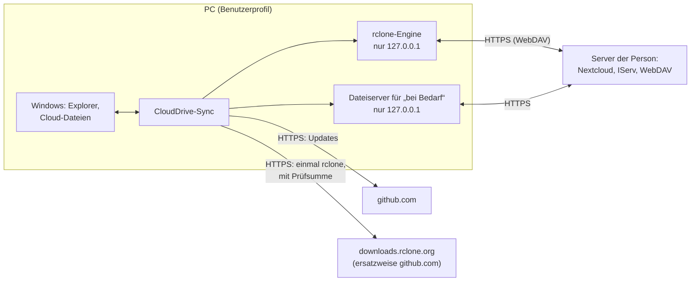

# Datenschutz und IT-Sicherheit

Diese Übersicht ist für **Datenschutzbeauftragte und IT-Verantwortliche**, etwa an Schulen, und für alle, die prüfen
wollen, was CloudDrive-Sync mit Daten macht. Sie beschreibt Datenflüsse, gespeicherte Daten, Protokolle, Zugangsdaten,
das Entfernen und die Bedrohungen, gegen die das Programm schützt, und die, gegen die es nicht schützen kann.

Kürzer, für Nutzerinnen und Nutzer: die [Datenschutzerklärung](../PRIVACY.md). Wie das Programm innen arbeitet:
[ARCHITECTURE.md](ARCHITECTURE.md). Stand: Version 0.3 (Testversionen), Oktober 2026.
*English: [PRIVACY-SECURITY.en.md](PRIVACY-SECURITY.en.md).*

## Auf einen Blick

- CloudDrive-Sync läuft **nur auf dem PC** der Person, die es nutzt. Es gibt keinen Server des Entwicklers, kein Konto
  beim Entwickler, **keine Telemetrie**, keine Absturzberichte, keine Werbung und keine Auswertung von Inhalten.
- Dateien fließen **nur zwischen dem PC und dem Server, den die Person selbst einträgt** (Nextcloud, IServ oder ein
  anderer WebDAV-Speicher), verschlüsselt über HTTPS.
- **Zugangsdaten** liegen nur verschlüsselt auf dem PC. Der Schlüssel steckt in der Windows-Anmeldeinformationsverwaltung
  und ist an die Windows-Anmeldung der Person gebunden.
- **Keine Administratorrechte:** Programm und Daten liegen im Benutzerprofil. Für „Dateien bei Bedarf“ nutzt
  CloudDrive-Sync die Cloud-Dateien-Schnittstelle von Windows (wie OneDrive), keinen eigenen Treiber und keinen Dienst.
- **Quelloffen** unter der MIT-Lizenz; alle Bestandteile stehen unter OSI-anerkannten Lizenzen
  ([THIRD-PARTY-NOTICES.md](../THIRD-PARTY-NOTICES.md)). Jede Version wird auf GitHub aus diesem Quellcode gebaut.
- **Deinstallieren** entfernt alles, was CloudDrive-Sync angelegt hat; die synchronisierten Dateien bleiben.

## Datenflüsse

| Verbindung | Wozu | Wann | Was übertragen wird |
|---|---|---|---|
| Server der Person | Abgleich, Ordnerliste, Speicherplatz, Anmeldung | bei jedem Lauf (Standard: alle 5 Minuten und nach Änderungen am PC) und beim Öffnen einer Datei „bei Bedarf“ | Dateien, Datei- und Ordnernamen, Zugangsdaten bei der Anmeldung |
| Browser → Nextcloud-Server | Anmeldung (Nextcloud Login Flow v2) | beim Hinzufügen eines Kontos | nur im Browser der Person; CloudDrive-Sync erhält ein App-Passwort |
| github.com | nach Updates sehen und sie laden | Standard: einige Minuten nach dem Start, dann alle 6 Stunden; mit „Nur wenn ich nachsehe“ nur auf Knopfdruck | technische Angaben jeder Webanfrage (IP-Adresse, Programmversion) |
| downloads.rclone.org, ersatzweise github.com | das Werkzeug rclone in der festen Version laden | beim ersten Start | technische Angaben der Webanfrage |
| 127.0.0.1 (nur dieser PC) | rclone-Engine, Dateiserver für „bei Bedarf“ | solange CloudDrive-Sync läuft | nichts nach außen |

Weitere Verbindungen gibt es nicht. Die Links unter „Über“ öffnen sich nur auf Klick im Browser.

**Verschlüsselung der Verbindungen:** Zertifikate werden immer geprüft; an keiner Stelle ist die Prüfung abgeschaltet.
Eine unverschlüsselte Adresse (`http://`) nimmt CloudDrive-Sync nur, wenn die Person das beim Einrichten ausdrücklich
ankreuzt; die Adressvorschau warnt davor.

## Was wo gespeichert wird

| Ort | Inhalt | Schutz | Aufbewahrung |
|---|---|---|---|
| `%LOCALAPPDATA%\CloudDriveSync` | das Programm | Benutzerprofil | bis zur Deinstallation |
| `%LOCALAPPDATA%\CloudDrive-Sync\settings.json` (und `.bak`) | Konten (Bezeichnung, Art, Benutzerkennung und Anzeigename auf dem Server), Synchronisationen (Ordner am PC und in der Cloud, Auswahl, ignorierte Pfade, Einstellungen) | Benutzerprofil; **keine Zugangsdaten** | bis zur Deinstallation |
| `…\CloudDrive-Sync\rclone.conf` | Serveradressen, Benutzernamen, Passwörter bzw. App-Passwörter | **verschlüsselt** (Verschlüsselung der rclone-Konfiguration) mit einem zufälligen Schlüssel | bis das Konto entfernt wird |
| Windows-Anmeldeinformationsverwaltung, Eintrag `CloudDrive-Sync:config` | der Schlüssel der `rclone.conf` | von Windows an die Anmeldung der Person gebunden | bis zur Deinstallation |
| `…\CloudDrive-Sync\sync\<Synchronisation>\` | Zustand jeder Synchronisation: Listen aller Dateien mit Größe und Zeit, Serverzeiten, Verlauf der Läufe mit Namen geänderter Dateien, Bericht des letzten Laufs | Benutzerprofil; Bericht geschwärzt | Listen: aktueller Stand; Verlauf: höchstens 400 Läufe; Bericht: nur der letzte |
| `…\CloudDrive-Sync\logs\` | Protokolle (siehe unten) | Geheimnisse geschwärzt | 14 Tage |
| `…\CloudDrive-Sync\deps\` | rclone | Prüfsumme beim Laden geprüft | bis zur Deinstallation |
| Registrierung, Bereich des Benutzers (HKCU) | Autostart, Programmpfad, Einträge im Navigationsbereich des Explorers | – | bis zum Entfernen bzw. zur Deinstallation |
| Registrierung von Windows (SyncRootManager) | Anmeldung jedes Ordners „bei Bedarf“: Name, Pfad, Symbol – von Windows selbst angelegt, wie bei OneDrive | von Windows verwaltet | bis zum Entfernen der Synchronisation |
| synchronisierter Ordner am PC | die Dateien; versteckt: `.clouddrive-sync` (Schutzdatei, fester Hinweistext) und `.clouddrive-papierkorb` (Fassungen, die ein Abgleich ersetzt oder gelöscht hat) | NTFS-Rechte der Person | Papierkorb: Standard 30 Tage, einstellbar, 0 = aus |
| Cloud-Ordner auf dem Server | die Dateien; `.clouddrive-sync` (fester Hinweistext, keine Angaben zu PC oder Person); für einen Moment `CloudDrive-Sync-Sicherung-….tmp` beim Ersetzen einer Datei („bei Bedarf“); Konfliktkopien `….Konflikt-PC1.…` | Rechte auf dem Server | Schutzdatei bleibt (andere PCs nutzen sie) |

Inhalte von Dateien speichert CloudDrive-Sync nirgends außer in den synchronisierten Ordnern selbst und ihrem Papierkorb.

## Protokolle

- **Protokoll von CloudDrive-Sync:** eine Datei pro Tag. Sie enthält Zeitpunkte, Vorgänge, Datei- und Ordnernamen (auch die
  Pfade der Ordner am PC), die Namen der Synchronisationen, die Adresse des Servers und Fehlermeldungen. Passwörter, Tokens und Anmeldeköpfe werden
  vor dem Schreiben geschwärzt. Dateien älter als 14 Tage werden gelöscht, beim Start und bei jedem Tageswechsel.
- **Protokoll von rclone:** ausführlicher, mit jeder übertragenen Datei und den Adressen auf dem Server (bei Nextcloud
  steht darin der Benutzername). Es wird in Teile zu höchstens 10 MB geteilt, höchstens 6 Teile. Abgeschlossene Teile
  werden nach 14 Tagen gelöscht; ein Teil mit Einträgen älter als 14 Tage wird beim Start abgeschlossen.
  Grenze: Läuft ein PC wochenlang ohne Neustart von CloudDrive-Sync, behält der offene Teil seine Einträge, bis er 10 MB
  erreicht.
- **Protokolle verlassen den PC nie von selbst.** Wer Hilfe braucht, kann sie selbst weitergeben – dann am besten nur den
  betroffenen Tag, denn sie enthalten Dateinamen.

## Zugangsdaten

- **Nextcloud:** Die Anmeldung geschieht im Browser auf dem eigenen Nextcloud-Server. CloudDrive-Sync erhält dabei ein
  eigenes **App-Passwort** und sieht das eigentliche Passwort nicht. Wird stattdessen ein Passwort eingegeben, tauscht
  CloudDrive-Sync es gleich in ein App-Passwort, wo Nextcloud das erlaubt. Ein App-Passwort lässt sich in Nextcloud unter
  *Einstellungen › Sicherheit* jederzeit widerrufen – etwa wenn ein Gerät verloren geht.
- **IServ und andere WebDAV-Speicher:** Benutzername und Passwort werden geprüft und nur in der verschlüsselten
  `rclone.conf` abgelegt.
- Zugangsdaten stehen nie in Protokollen, nie auf der Befehlszeile eines Prozesses und nie im Quellcode-Repository.

## Lokale Dienste

CloudDrive-Sync startet rclone als Engine (`rclone rcd`) und für „Dateien bei Bedarf“ einen Dateiserver je Konto. Beide
lauschen **nur auf 127.0.0.1** – also nicht im Netz –, auf einem zufälligen Port und mit **zufälligen Zugangsdaten, die
bei jedem Start neu entstehen**. Diese gibt CloudDrive-Sync nur über die Umgebung des Kindprozesses weiter, nie über die
Befehlszeile. Andere Windows-Benutzer desselben PCs erreichen den Port zwar, kommen ohne diese Zugangsdaten aber nicht
hinein.

## Entfernen und Deinstallieren

- **Synchronisation entfernen:** Die Person wählt, was auf dem PC bleibt (alles behalten, alles laden und behalten oder
  vom PC löschen). Die Anmeldung bei Windows endet erst, wenn nichts mehr von ihr übrig ist.
- **Konto entfernen:** Die Zugangsdaten verschwinden aus der `rclone.conf`. Ein Nextcloud-App-Passwort sollte zusätzlich
  in Nextcloud widerrufen werden.
- **Deinstallieren** entfernt den Datenordner (Einstellungen, verschlüsselte Zugangsdaten, Zustand, Protokolle, rclone),
  den Schlüssel in der Windows-Anmeldeinformationsverwaltung, die Anmeldungen der Ordner bei Windows, die Explorer-Einträge,
  den Autostart und die Schutzdateien am PC. **Es bleiben:** die synchronisierten Ordner mit allen Dateien, ihr Papierkorb
  `.clouddrive-papierkorb` (er enthält ältere Fassungen – bei Bedarf selbst löschen) und die Schutzdatei in der Cloud.

## Bedrohungen und Schutz

| Bedrohung | Schutz in CloudDrive-Sync | Was bleibt |
|---|---|---|
| Gerät geht verloren oder wird gestohlen | Zugangsdaten verschlüsselt; Schlüssel an die Windows-Anmeldung gebunden | Die synchronisierten Dateien liegen wie bei jedem Sync-Programm unverschlüsselt auf der Festplatte → Geräteverschlüsselung (BitLocker) nutzen, App-Passwort widerrufen |
| Andere Personen am selben PC | alles im eigenen Benutzerprofil; lokale Dienste nur mit zufälligen Zugangsdaten | Administratoren des PCs können alles lesen – wie bei jedem Programm |
| Schadsoftware unter dem eigenen Windows-Konto | – | Sie kann alles, was die Person kann, auch Zugangsdaten über Windows entschlüsseln. Kein Programm kann sich davor schützen → Virenschutz, Updates |
| Mitlesen oder Verändern im Netz (z. B. WLAN) | HTTPS mit Zertifikatsprüfung; `http://` nur nach ausdrücklicher Bestätigung | Bei `http://` ist alles lesbar → nicht verwenden |
| Böswillige oder fehlerhafte Einträge auf dem Server (z. B. in einem geteilten Ordner) | Namen vom Server bleiben Namen im Ordner und erreichen keine Datei außerhalb (getestet); Löschschutz; ersetzte und gelöschte Fassungen in den Papierkorb am PC; bei Konflikten bleiben beide Fassungen; Ordner nur zum Lesen werden erkannt | Inhalte von Dateien prüft CloudDrive-Sync nicht → Virenschutz |
| Viele Dateien verschwinden auf einer Seite (Versehen, Fehler, Ordner verschoben) | Löschschutz: Stopp und Nachfrage ab 50 % oder 100 Dateien (einstellbar); fehlt der Ordner oder seine Schutzdatei, hält der Abgleich an, statt zu löschen | – |
| Manipuliertes Update | Updates nur aus den GitHub-Releases dieses Projekts, über HTTPS; jede Version wird auf GitHub aus dem Quellcode gebaut; das Update-System prüft die Prüfsumme jedes Pakets | Noch **keine Codesignatur** (beantragt bei der SignPath Foundation). Restrisiko: ein übernommenes GitHub-Konto des Entwicklers |
| Manipuliertes rclone | feste Version mit festgelegter SHA-256-Prüfsumme im Programm; nur über HTTPS von rclone.org bzw. GitHub | – |
| Zugriff anderer Programme auf die lokalen Dienste | nur 127.0.0.1; zufällige Zugangsdaten je Start; Übergabe nur über die Umgebung des Kindprozesses | Programme unter demselben Windows-Konto: siehe Schadsoftware |
| Datenreste nach dem Deinstallieren | siehe „Entfernen und Deinstallieren“ | der Papierkorb in den synchronisierten Ordnern (Daten der Person, bewusst nicht gelöscht) |
| Einstellungen für Entwickler | Die Umgebungsvariablen `CLOUDDRIVE_SYNC_HOME` (anderer Datenordner) und `CLOUDDRIVE_SYNC_RCLONE` (rclone ohne Prüfsumme aus einer Datei) wirken nur, wenn jemand sie im Konto der Person setzt | nur mit Schreibzugriff auf das Windows-Konto der Person – siehe Schadsoftware |

## Empfehlungen für den Einsatz

- Auf Dienst- und Leihgeräten die **Geräteverschlüsselung** (BitLocker) einschalten.
- Bei Nextcloud die **Anmeldung im Browser** nutzen (App-Passwort) und es bei Verlust eines Geräts widerrufen.
- Jede Person mit **eigenem Windows-Konto**; keine gemeinsamen Konten.
- Updates auf „Hinweis zeigen“ (Standard) oder „Automatisch installieren“ lassen.
- Den **Papierkorb am PC** (Einstellungen) nach Bedarf einstellen – bei sensiblen Daten kürzer.
- **Protokolle** nur gezielt weitergeben: Sie enthalten Datei- und Ordnernamen.
- Keine unverschlüsselten Adressen (`http://`) verwenden.

## Nachprüfen

Der gesamte Quellcode liegt öffentlich auf [GitHub](https://github.com/suebi76/CloudDrive-Sync). Jede Änderung steht im
[CHANGELOG](../CHANGELOG.md); Sicherheitskorrekturen stehen dort unter „Security“. Über 400 automatische Tests prüfen
unter anderem, dass nichts verloren geht, dass Namen vom Server keine Dateien außerhalb des Ordners erreichen, dass
Protokolle nach 14 Tagen gehen und dass Deinstallieren keine Reste lässt.
